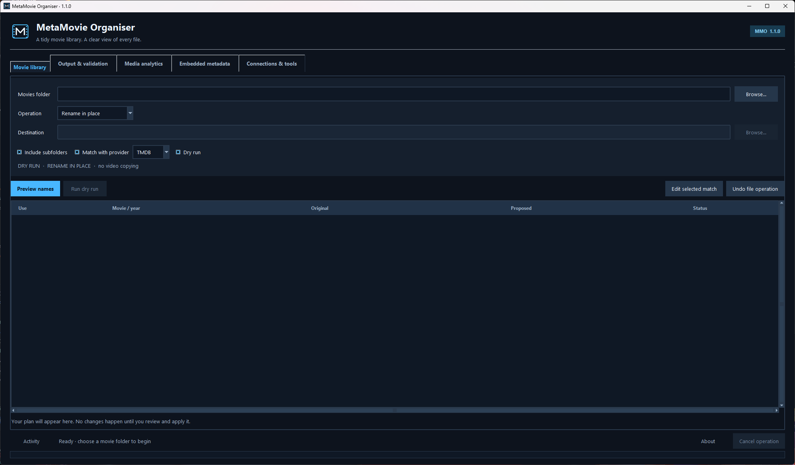
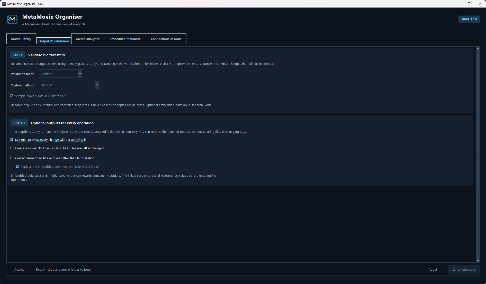
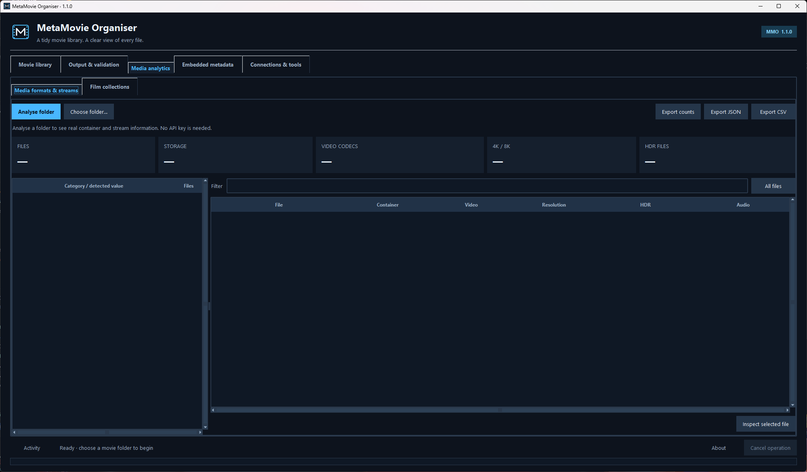
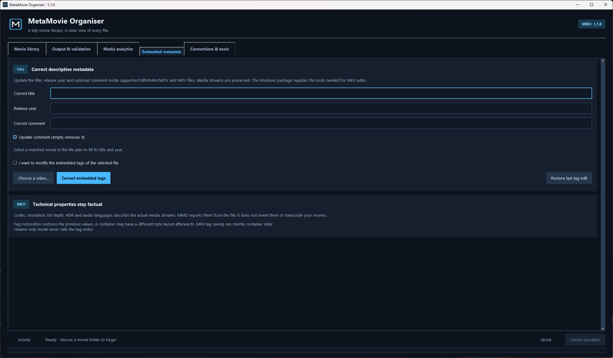
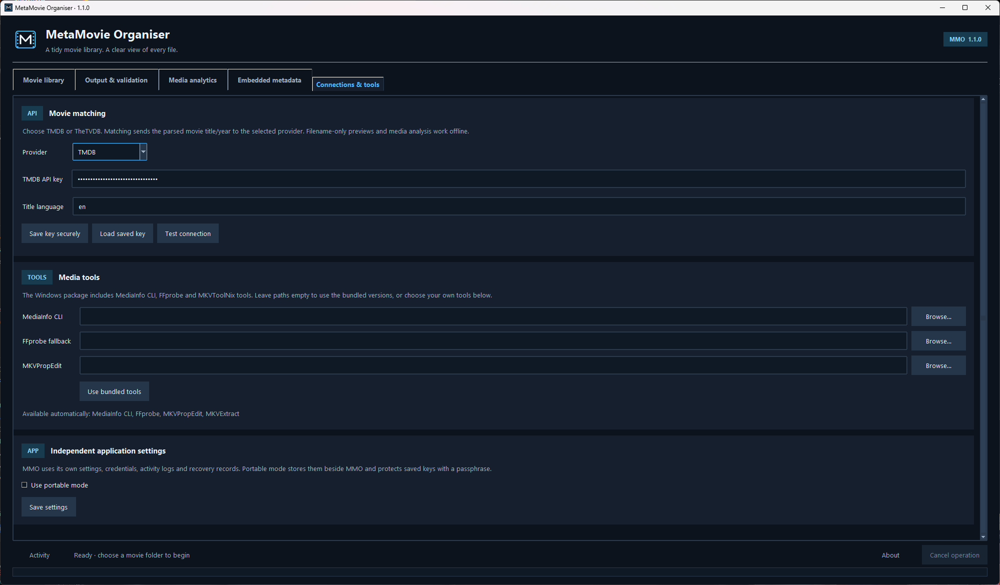

# MetaMovie Organiser

Match, rename and organise a movie collection with metadata from TMDB or TheTVDB. Scan a folder of films or its subfolders, review each match, and choose whether to rename files where they are or organise them into individual movie folders.

**MMO 1.1.1 · Python 3.11+ · Windows desktop**

## Windows download

[**Download MetaMovie-Organiser 1.1.1 for Windows**](https://github.com/ollie394/MetaMovie-Organiser/releases/download/v1.1.1/MetaMovie-Organiser-Windows.zip)

Extract the entire ZIP, then run `MetaMovie-Organiser.exe`. Keep the included `_internal` folder beside it. You do not need to install Python.

[Release notes, source and checksums](https://github.com/ollie394/MetaMovie-Organiser/releases/tag/v1.1.1).

[](docs/images/movie-library.png)

| Output & validation | Media analytics |
| --- | --- |
| [](docs/images/output-validation.png) | [](docs/images/media-analytics.png) |
| **Embedded metadata** | **Connections & tools** |
| [](docs/images/embedded-metadata.png) | [](docs/images/connections-tools.png) |

Click any screenshot to view it at full size.

## Choose how to organise your films

**Rename in place** uses filesystem renames to organise filenames and movie folders on their current drive. It does not copy or stream the movie contents. A reviewed filename such as `Batman.Begins.2005.1080p.mkv` becomes `Batman Begins (2005)/Batman Begins (2005).mkv`. An existing single-movie subfolder can be renamed with its contents.

**Organise** moves or copies approved files into a movie library:

```text
Movies/
├── Avatar (2009)/
│   └── Avatar (2009).mkv
└── Batman Begins (2005)/
    ├── Batman Begins (2005).mp4
    ├── Batman Begins (2005).en.srt
    └── poster.jpg
```

Associated subtitles keep their language and accessibility suffixes, including subtitles stored under a movie's `Subs` or `Subtitles` folder. An existing local poster follows its movie when the association is clear. Uncertain associations and conflicting files require review; existing files are never overwritten. Poster downloads and transcoding are outside this workflow.

## Install and run

Install [Python 3.11 or newer](https://www.python.org/downloads/windows/) with Tcl/Tk support, then open PowerShell in this folder:

```powershell
py -3 -m venv .venv
.\.venv\Scripts\python.exe -m pip install --upgrade pip
.\.venv\Scripts\python.exe -m pip install -r requirements.txt
.\.venv\Scripts\python.exe mmo.py
```

Windows is the primary target. The Windows `pymediainfo` wheel includes the MediaInfo library used for analysis; the packaged app includes that library too. Other platforms require their own native MediaInfo installation and GUI validation.

## Review a batch

1. Select a source folder. Enable subfolder scanning if the movies are spread across a folder tree.
2. Choose **Rename in place**, or choose an organise operation and destination movie library.
3. Select TMDB or TVDB in **Connections & tools**, enter that provider's API key and test the connection. TVDB's optional subscriber PIN is only needed when your key requires it. Enable **Match with provider** for online movie matching. The providers have separate credentials; get access through [TMDB](https://www.themoviedb.org/) or [TheTVDB](https://thetvdb.com/). You can also preview names offline and correct titles and years manually.
4. Choose **Preview names**. Review each movie's title, release year, proposed filename and associated files. Use **Edit selected match** for uncertain titles or years, and double-click a row to include or exclude a resolved movie.
5. **Dry run** is enabled by default. Run the approved plan in this mode to inspect the proposed file, NFO and tag actions while leaving the media untouched. Turn Dry run off before choosing **Apply approved plan** to make the reviewed changes.

Each movie is matched separately. The source folder can contain many different films. A folder tree is scanned as a batch of movies, rather than being treated as one title.

File operations have their own recovery journal. **Undo file operation** uses that journal to restore file locations or remove unchanged copies. It checks recorded ownership and content information, and leaves files alone when it cannot safely verify them. Cancellation stops at a checkpoint; completed steps stay available for Undo.

### Output and validation

In **Output & validation**, choose the transfer checks for Copy and Move:

| Mode | Behaviour |
| --- | --- |
| Verified | Full BLAKE3 verification, the default. |
| Quick | File identity for same-volume moves; sampled copy checks by default, or size/identity checks when sampling is disabled. |
| Custom | XXH3-128, BLAKE3, SHA-256, a sampled fingerprint, size/identity checks or skipped content verification. |

Partial checks can miss corruption. Rename in place uses identity and snapshot guards without hashing or copying movie contents; transfer-validation settings do not make it copy files.

Optional output settings apply to all three operations. **Create a movie NFO file** writes available title, year, plot, genres and provider ID beside the movie; existing NFO files are left unchanged. **Correct embedded title and year** runs a separate metadata edit after the file operation. Its comment option replaces the targeted comment with `Movie title (Year)`. Both features are off until selected.

When tags or NFO files were created through this workflow, the linked recovery record restores tag values and checks generated sidecars before undoing file operations. This remains distinct from a byte-exact restoration of a rewritten container.

## Inspect the collection

In **Media analytics**, choose **Analyse folder** to read technical information from each file and its streams. The analysis view reports available container, video, audio and subtitle details. Double-click a file to inspect its stream fields and raw MediaInfo data.

Category totals count distinct files. A movie containing both AAC and AC-3 audio belongs to both codec categories; the separate stream totals count every track. External subtitle codec/language counts are reported separately from embedded subtitle streams. JSON preserves the full records and aggregates. The detailed CSV contains one row per file with values from multiple streams separated by ` | `. **Export counts** writes a separate summary CSV with its counting basis stated in each row.

Fields depend on what the file and MediaInfo report. Missing information remains **Unknown**, **Not reported**, or an empty/null value in exports. HDR labels follow reported format information; resolution, bit depth or a codec name alone do not prove a file is HDR. A scan can finish with some or all files unreadable; inspect the issue count and each file's error before drawing conclusions from the category totals. Exported reports can contain full file paths, so review them before sharing them.

The Windows package includes MediaInfo CLI 26.10, FFprobe 9.0.2 and MKVToolNix 103.0 command-line tools. Leave the paths in **Connections & tools** blank to use these bundled versions. Explicit paths override them; **Use bundled tools** clears those overrides. MediaInfo's Python library remains the normal analysis engine, with CLI/FFprobe fallback available. A source checkout can prepare the tools using the build instructions below or use existing tool paths.

Detailed viewers support wrapping and horizontal/vertical scrolling. Select a property to inspect its full value when a long field or raw JSON does not fit the table.

### Film series and box sets

The film-collections view under **Media analytics** compares your library with TMDB's collection membership. This lookup uses a TMDB API key even when TVDB is selected for filename matching. Only parsed movie titles and years are sent as search queries; local filenames, folder paths and movie contents are not uploaded.

Results distinguish confirmed movies in your library from released movies not found by the comparison. Upcoming releases appear separately. Unmatched or ambiguous local files remain visible as uncertainty: a movie reported as not found may already be present under an unresolved filename, so review those files before treating the collection as incomplete.

This is a read-only comparison. It does not download movies or change filenames. Collection reports can be exported as JSON or CSV. Cached lookups are separated by query and language and expire after a time limit; **Refresh** requests fresh provider data.

## Optional embedded title correction

Renaming a file and changing its embedded metadata are separate operations. The **Embedded metadata** tab provides an explicit action for supported title/year/comment tags, while **Output & validation** can opt into those edits after a reviewed rename, Copy or Move. Scanning and matching alone do not write embedded metadata.

- MP4, M4V and supported MOV containers use Mutagen for tag edits. A filename extension alone does not guarantee a compatible container; an unsupported or damaged file is reported without a successful tag edit.
- MKV segment title, release-year and comment edits use the bundled `mkvpropedit` and `mkvextract` from [MKVToolNix](https://mkvtoolnix.download/), retaining unrelated tag XML. Existing tools can be selected in **Connections & tools**.
- Other containers remain read-only for this feature. There is no transcoding.

Tag edits use a separate journal. **Restore last tag edit** restores the prior supported tag values; it is a semantic restoration and does not promise the original file bytes or layout. Metadata tools may rewrite container metadata, so these edits are distinct from the no-copy rename operation. Linked workflow edits are coordinated with file-operation Undo; unrelated later file changes can still prevent automatic restoration.

## Settings and credentials

MMO stores normal application state separately from MetaSeries Organiser:

```text
%LOCALAPPDATA%\MetaMovie-Organiser\
```

This contains settings, logs and recovery records. Normal-mode credentials use MMO's own service in the operating system keyring. When secure credential storage is unavailable, credentials are retained for the current session and the app reports that they were not saved.

Portable mode stores state in `data` beside the script or executable, with an AES-GCM encrypted credential vault protected by a passphrase. Enable it in **Connections & tools**, set `MMO_PORTABLE=1`, or place an empty `portable.flag` beside the script or executable. The application folder must be writable. Keep the passphrase somewhere you can retrieve it; the app cannot recover it for you.

For isolated development and GUI checks, set `MMO_STATE_DIR` to a disposable directory. The override also applies in portable mode. It redirects file-based state; the operating system keyring remains a separate credential backend.

## Build the Windows application

```powershell
.\.venv\Scripts\python.exe -m pip install -r requirements-dev.txt
.\scripts\build-windows.ps1
```

The result is `dist\1.1.1\MetaMovie-Organiser\MetaMovie-Organiser.exe`, along with Windows/source ZIPs and SHA-256 checksums. Distribute the whole application folder, including `_internal`. Users do not need a separate Python installation or separately installed media tools to run the Windows package.

Native preparation needs Visual Studio C++ Build Tools and Git for Windows. The script downloads pinned official MediaInfo/MKVToolNix archives, builds FFprobe from unmodified FFmpeg source with optional external libraries disabled, and retains the native source/licence material. Downloads and compilation stay inside the project. Run `python scripts/prepare_tools.py` separately to prepare these tools for a source checkout.

For another Python environment, pass `-Python "C:\path\to\python.exe"`; `-DistPath` selects a separate output folder. The large `MetaMovie-Organiser-NativeToolSources.zip` accompanies the Windows ZIP as a separate release asset. The small source-upload ZIP excludes downloaded tools and large native sources. See the [native source inventory](docs/native-tool-sources.md) for exact hashes and verified versus inferred provenance.

## Development and releases

```powershell
.\.venv\Scripts\python.exe -m pytest -q
.\.venv\Scripts\python.exe scripts\package_source.py
```

Tests use disposable files and mocked provider responses, with native-tool checks on generated media. They do not establish that a live TMDB/TVDB account works, or that every real-world media file can be analysed or edited. See [CONTRIBUTING.md](CONTRIBUTING.md), the [release guide](docs/releasing.md), [validation notes](docs/validation.md) and the [changelog](CHANGELOG.md).

## Licence and acknowledgements

The application source is available under the [MIT licence](LICENSE). The combined Windows distribution includes GPL-2.0-or-later Mutagen and other dependencies under their own terms; it is not an MIT-only binary. The package includes full licence texts, MMO's source and build scripts, and the installed Mutagen Python source alongside the executable. See [DISTRIBUTION-LICENCE.md](DISTRIBUTION-LICENCE.md) and [ATTRIBUTION.md](ATTRIBUTION.md).

This product uses the TMDB API but is not endorsed or certified by TMDB.

Metadata is also provided by [TheTVDB](https://thetvdb.com/). Please consider contributing missing information or [subscribing](https://thetvdb.com/subscribe).

## Development history

See [the development history](HISTORY.md) for earlier source snapshots and how they relate to the current release.
