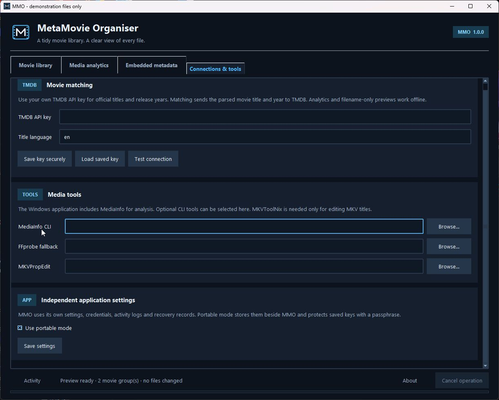

# MetaMovie Organiser

Match, rename and organise a movie collection with metadata from TMDB. Scan a folder of films or its subfolders, review each match, and choose whether to rename files where they are or organise them into individual movie folders.



**MMO 1.0.0 · Python 3.11+ · Windows desktop**

## Choose how to organise your films

**Rename in place** uses filesystem renames to organise filenames and movie folders on their current drive. It does not copy or stream the movie contents. A reviewed filename such as `Batman.Begins.2005.1080p.mkv` becomes `Batman Begins (2005)/Batman Begins (2005).mkv`. An existing single-movie subfolder can be renamed with its contents.

**Organise** moves or copies approved files into a movie library:

```text
Movies/
├── Avatar (2009)/
│   └── Avatar (2009).mkv
└── Batman Begins (2005)/
    ├── Batman Begins (2005).mp4
    ├── Batman Begins (2005).en.srt
    └── poster.jpg
```

Associated subtitle names keep their language and accessibility suffixes. An existing local poster follows its movie when the association is clear. Uncertain matches and conflicting files require review; existing files are never overwritten. Poster downloads and transcoding are outside this workflow.

## Install and run

Install [Python 3.11 or newer](https://www.python.org/downloads/windows/) with Tcl/Tk support, then open PowerShell in this folder:

```powershell
py -3 -m venv .venv
.\.venv\Scripts\python.exe -m pip install --upgrade pip
.\.venv\Scripts\python.exe -m pip install -r requirements.txt
.\.venv\Scripts\python.exe mmo.py
```

Windows is the primary target. The Windows `pymediainfo` wheel includes the MediaInfo library used for analysis; the packaged app includes that library too. Other platforms require their own native MediaInfo installation and GUI validation.

## Review a batch

1. Select a source folder. Enable subfolder scanning if the movies are spread across a folder tree.
2. Choose **Rename in place**, or choose an organise operation and destination movie library.
3. To match against TMDB, enter your API key in **Connections & tools**, test the connection, and enable **Match titles with TMDB**. Get a key through your account at [TMDB](https://www.themoviedb.org/). You can also preview names offline and correct titles and years manually.
4. Choose **Preview names**. Review each movie's title, release year, proposed filename and associated files. Use **Edit selected match** for uncertain titles or years, and double-click a row to include or exclude a resolved movie.
5. Previewing leaves the files untouched. Choose **Apply approved plan** only after the plan is correct, then confirm the reviewed operation.

Each movie is matched separately. The source folder can contain many different films. A folder tree is scanned as a batch of movies, rather than being treated as one title.

File operations have their own recovery journal. **Undo file operation** uses that journal to restore file locations or remove unchanged copies. It checks recorded ownership and content information, and leaves files alone when it cannot safely verify them. Cancellation stops at a checkpoint; completed steps stay available for Undo.

## Inspect the collection

In **Media analytics**, choose **Analyse folder** to read technical information from each file and its streams. The analysis view reports available container, video, audio and subtitle details. Double-click a file to inspect its stream fields and raw MediaInfo data.

Category totals count distinct files. A movie containing both AAC and AC-3 audio belongs to both codec categories; the separate stream totals count every track. JSON preserves the full records and aggregates. The detailed CSV contains one row per file with values from multiple streams separated by ` | `. **Export counts** writes a separate summary CSV with its counting basis stated in each row.

Fields depend on what the file and MediaInfo report. Missing information remains **Unknown**, **Not reported**, or an empty/null value in exports. HDR labels follow reported format information; resolution, bit depth or a codec name alone do not prove a file is HDR. A scan can finish with some or all files unreadable; inspect the issue count and each file's error before drawing conclusions from the category totals. Exported reports can contain full file paths, so review them before sharing them.

Optional external MediaInfo CLI and FFprobe paths can be configured in **Connections & tools**. Normal analysis uses the bundled MediaInfo library.

## Optional embedded title correction

Renaming a file and changing its embedded metadata are separate operations. The **Embedded metadata** tab provides an explicit action for supported title/year tags. Nothing is written to embedded metadata just because a movie was scanned, matched or renamed.

- MP4, M4V and supported MOV containers use Mutagen for tag edits. A filename extension alone does not guarantee a compatible container; an unsupported or damaged file is reported without a successful tag edit.
- MKV segment-title edits require a working external `mkvpropedit` from [MKVToolNix](https://mkvtoolnix.download/). Configure its path in **Connections & tools**.
- Other containers remain read-only for this feature. There is no transcoding.

Tag edits use a separate journal. **Restore last tag edit** restores the prior supported tag values; it is a semantic restoration and does not promise the original file bytes or layout. Metadata tools may rewrite container metadata, so these edits are distinct from the no-copy rename operation. File-operation Undo refuses files changed by later tag edits; it may continue to require manual review after a semantic tag restoration.

## Settings and credentials

MMO stores normal application state separately from MetaSeries Organiser:

```text
%LOCALAPPDATA%\MetaMovie-Organiser\
```

This contains settings, logs and recovery records. Normal-mode credentials use MMO's own service in the operating system keyring. When secure credential storage is unavailable, credentials are retained for the current session and the app reports that they were not saved.

Portable mode stores state in `data` beside the script or executable, with an AES-GCM encrypted credential vault protected by a passphrase. Enable it in **Connections & tools**, set `MMO_PORTABLE=1`, or place an empty `portable.flag` beside the script or executable. The application folder must be writable. Keep the passphrase somewhere you can retrieve it; the app cannot recover it for you.

For isolated development and GUI checks, set `MMO_STATE_DIR` to a disposable directory. The override also applies in portable mode. It redirects file-based state; the operating system keyring remains a separate credential backend.

## Build the Windows application

```powershell
.\.venv\Scripts\python.exe -m pip install -r requirements-dev.txt
.\scripts\build-windows.ps1
```

The result is `dist\MetaMovie-Organiser\MetaMovie-Organiser.exe`, along with a Windows ZIP and SHA-256 checksum. Distribute the whole application folder, including `_internal`. Users do not need a separate Python installation to run it.

For another Python environment, pass `-Python "C:\path\to\python.exe"` to the build script. Build on Windows. Optional external tools are not included.

## Development and releases

```powershell
.\.venv\Scripts\python.exe -m pytest -q
.\.venv\Scripts\python.exe scripts\package_source.py
```

Tests use disposable files and mocked metadata responses. They do not establish that a live TMDB account works, or that every real-world media file can be analysed or edited. See [CONTRIBUTING.md](CONTRIBUTING.md), the [release guide](docs/releasing.md) and the [changelog](CHANGELOG.md).

## Licence and acknowledgements

The application source is available under the [MIT licence](LICENSE). The combined Windows distribution includes GPL-2.0-or-later Mutagen and other dependencies under their own terms; it is not an MIT-only binary. The package includes full licence texts, MMO's source and build scripts, and the installed Mutagen Python source alongside the executable. See [DISTRIBUTION-LICENCE.md](DISTRIBUTION-LICENCE.md) and [ATTRIBUTION.md](ATTRIBUTION.md).

This product uses the TMDB API but is not endorsed or certified by TMDB.
